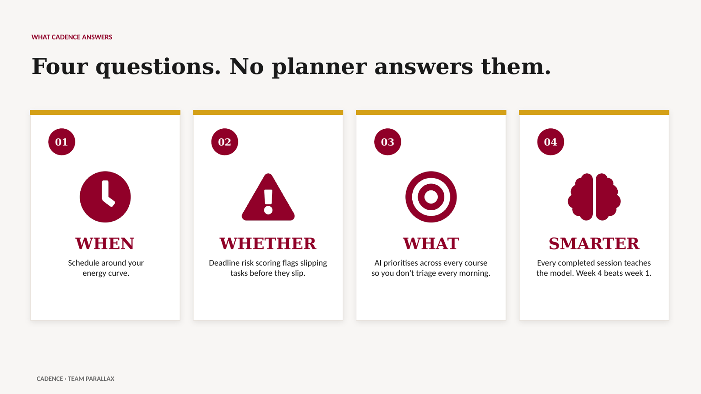
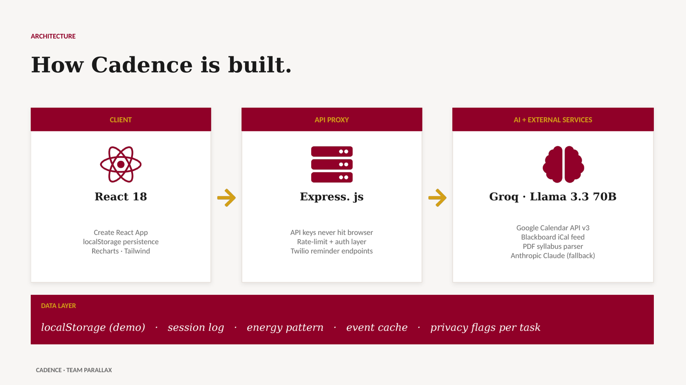
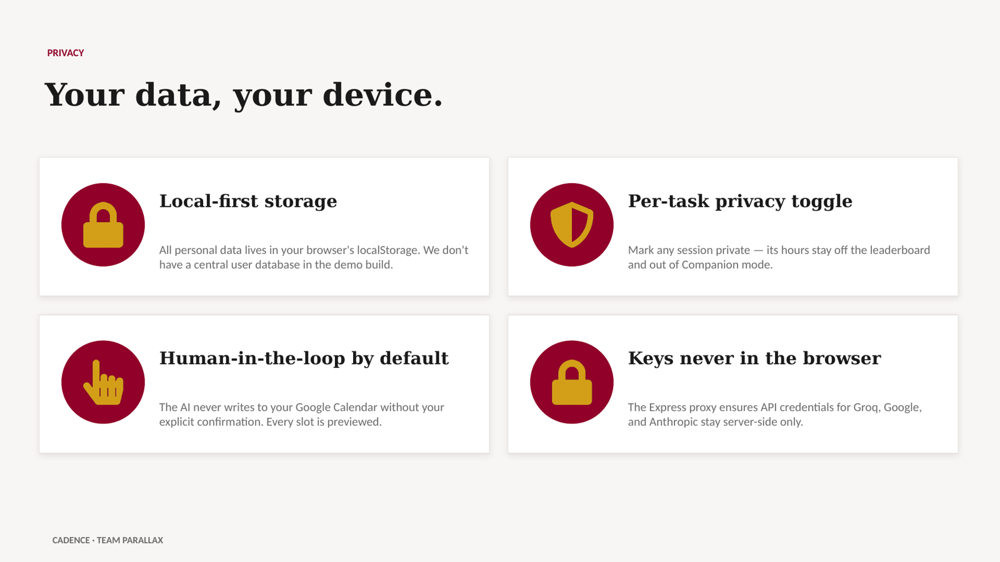

# Cadence — Adaptive Academic Planner
### Fordham University · AI Challenge 2026

An intelligent academic calendar that learns your energy patterns, schedules tasks at your peak hours, detects deadline risks before they happen, and gets smarter every time you use it.



---

## Table of Contents

- [Overview](#overview)
- [Team](#team)
- [Key Features](#key-features)
- [Tech Stack](#tech-stack)
- [Project Structure](#project-structure)
- [Setup & Installation](#setup--installation)
- [Environment Variables](#environment-variables)
- [Running the App](#running-the-app)
- [Feature Walkthrough](#feature-walkthrough)
- [AI Architecture](#ai-architecture)
- [Data Model](#data-model)
- [Known Issues & Backlog](#known-issues--backlog)
- [Troubleshooting](#troubleshooting)

---

## Overview

Cadence is a full-stack AI academic planner built for the Fordham 2026 AI Challenge. It solves a real problem for students and graduate assistants: **academic calendars don't adapt to how you actually work.**

Traditional calendars show you what's due. Cadence tells you:

- **When** to work on it — based on your natural energy rhythm
- **Whether** you'll realistically finish it on time — deadline risk scoring
- **What to do today** — the AI prioritises so you don't have to
- And it gets smarter over time — every focus session and every schedule edit teaches the model

---

## Team

**Team Parallax** — Fordham University, AI Challenge 2026

- Deepika Sethi
- Jayati Dua
- Prerna Palawat

---

## Key Features

### Unified Calendar
- Merges syllabus deadlines, Blackboard events, manually added tasks and Google Calendar in one week view
- Colour-coded by source: **Course** (maroon), **Study block** (amber), **Manual** (slate), **Google Calendar** (teal)
- Priority stripe on the left edge; badge icon on the title
- Filter chips + legend so you can isolate any source
- Two-way Google Calendar integration (see [Sync direction](#sync-direction))

### Today View — Your Daily Home Base
- Hour-by-hour plan, colour-matched to the Calendar
- Deadline risk board (time-left · estimated effort · your completion history)
- At-risk deadlines collapse with their study blocks so one task is one row
- Click any row → focus-session modal with timer, privacy toggle, and related blocks

### Focus Profile — Energy-Aware Scheduling
- Six-question quiz (or 4 quick templates) to learn your 24h energy curve
- Powers every AI scheduling decision: hard tasks land in your peak hours, readings in your low-energy windows
- Retake anytime; the AI re-plans from your new profile

### Smart Scheduler
- Llama 3.3 70B (via Groq) reads your upcoming deadlines + energy pattern and proposes slots for the week
- Slots are colour-coded by energy match (peak / medium / low)
- Inline edit / bulk accept / bulk reject — the model learns from every interaction
- Changes propagate instantly to Today, Calendar, and Insights

### Focus Sessions
- Live timer with pause / resume / stop
- Per-task privacy toggle (public hours count toward Focus Circle rank; private hours stay off the leaderboard)
- Every session is logged and feeds the pattern learner

### AI Schedule Assistant
- Chat panel on Today that understands your full context
- Example prompts: *"What's my riskiest deadline?"*, *"Move Tomorrow's assignment to 3pm"*, *"Protect Thursday evening — exam on Friday"*
- Every change is previewed; nothing applies until you hit **Apply**

### Insights
- Four KPI cards (events, AI scheduled, avg focus score, Blackboard count)
- Priority donut, event-type bar chart, 24h energy heatmap
- Due-this-week list with past-dates filtered out
- Syllabus summaries for quick reference

### Companion Mode (Optional)
- "Strava for studying" — create a focus circle, invite friends by code, see a weekly leaderboard
- Only public focus hours count — private sessions are hidden by design

---

## Tech Stack

| Layer | Tech |
|---|---|
| Frontend | React 18 · Create React App · React Router |
| Styling | Pure CSS with Fordham design tokens (maroon `#900028`, gold `#d4a017`, warm off-white `#f8f6f4`) |
| Charts | Recharts |
| State | React hooks + `localStorage` persistence (no backend DB required for demo) |
| AI | Groq Llama 3.3 70B Versatile (primary) · Anthropic Claude (fallback) |
| Calendar API | Google Calendar REST v3 · direct OAuth 2.0 client flow |
| Backend | Node / Express (`/server`) — proxies AI calls, Twilio WhatsApp reminders |
| Extension | Chrome MV3 sidepanel (`/smart-calendar-extension`) — optional companion |
| Data sources | Blackboard iCal feed · PDF syllabus parser · manual entry · Google Calendar |

---

## Project Structure

```
cadence-academic-planner/
├── src/
│   ├── App.jsx                    # shell, auth, navigation, hydration
│   ├── App.css                    # design tokens + global styles
│   ├── components/
│   │   ├── CalendarView.jsx       # week/month grid, colour-coded events
│   │   ├── TodayView.jsx          # daily plan + risk board + AI chat
│   │   ├── SmartScheduler.jsx     # AI-proposed slots, inline edit
│   │   ├── EnergyTracker.jsx      # focus profile quiz + templates
│   │   ├── SyllabusUploader.jsx   # PDF parser
│   │   ├── ActivityLogger.jsx     # manual session logging
│   │   ├── TaskDetailModal.jsx    # focus timer + privacy + linked blocks
│   │   ├── CompanionMode.jsx      # social focus circles
│   │   ├── AIChat.jsx             # schedule assistant
│   │   ├── LoginPage.jsx          # Fordham-themed hero + sign-in
│   │   └── …
│   ├── hooks/
│   │   └── useGoogleCalendar.js   # OAuth + fetch + push + cleanup
│   ├── utils/
│   │   ├── patternLearner.js      # session logger + inference
│   │   ├── riskScoring.js         # deadline risk math
│   │   ├── icalParser.js          # Blackboard iCal → events
│   │   ├── eventLinks.js          # parentKey matching for linked blocks
│   │   ├── taskPrivacy.js         # per-task public/private flag
│   │   ├── syllabusStore.js       # parsed-syllabus cache
│   │   └── …
│   └── api/
│       └── gemini.js              # AI client for the /server proxy (Groq; filename is historical)
├── server/
│   ├── index.js                   # Express proxy + Twilio endpoints
│   └── package.json
├── smart-calendar-extension/      # Chrome MV3 sidepanel (optional)
├── public/
│   ├── fordham-logo.png           # Fordham crest (used in hero + sidebar)
│   └── index.html
├── BACKLOG.md                     # deferred features and bugs
├── SETUP_GOOGLE_CALENDAR.md       # OAuth setup walkthrough
├── EMAIL_SETUP.md                 # Twilio reminder setup
├── .env.local.example             # template — copy to .env
└── README.md                      # you are here
```

---

## Setup & Installation

```bash
# Clone
git clone https://github.com/jayatidua305-tech/cadence-academic-planner.git
cd cadence-academic-planner

# Frontend deps
npm install

# Backend deps
cd server && npm install && cd ..

# Copy env template and fill in
cp .env.local.example .env
# Then edit .env — see the next section
```

---

## Environment Variables

Copy `.env.local.example` → `.env` and fill in:

| Variable | Required? | Where to get it |
|---|---|---|
| `REACT_APP_GOOGLE_CLIENT_ID` | Yes (for GCal sync) | [console.cloud.google.com/apis/credentials](https://console.cloud.google.com/apis/credentials) |
| `REACT_APP_GOOGLE_API_KEY` | Optional | same console |
| `REACT_APP_GROQ_API_KEY` | Yes (AI features) | [console.groq.com](https://console.groq.com) |
| `REACT_APP_ANTHROPIC_API_KEY` | Optional fallback | [console.anthropic.com](https://console.anthropic.com) |
| `TWILIO_ACCOUNT_SID` | Only if using WhatsApp reminders | [console.twilio.com](https://console.twilio.com) |
| `TWILIO_AUTH_TOKEN` | Only if using WhatsApp reminders | same |
| `TWILIO_WHATSAPP_FROM` | Only if using WhatsApp reminders | same |

`.env` is gitignored. Never commit real credentials.

---

## Running the App

### Development (two terminals)

```bash
# Terminal 1 — backend on :3001
cd server
npm start

# Terminal 2 — frontend on :3000
npm start
```

Open [http://localhost:3000](http://localhost:3000).

### Production Build

```bash
npm run build
# serves /build — deploy to any static host
```

---

## Feature Walkthrough

A suggested first-run path:

1. **Sign in** — any `@fordham.edu` email works (demo mode — no password)
2. **Focus Profile** — take the 6-question quiz or pick a template (Early Bird / Night Owl / Afternoon / Split Peak)
3. **Add events** — upload a PDF syllabus, paste a Blackboard iCal URL, or manually add tasks
4. **Connect Google Calendar** — one-click OAuth, your events merge into the grid
5. **Build schedule** — click **🧠 Build my smart schedule** on the Schedule tab
6. **Edit / accept / reject** — the AI learns from every interaction
7. **Push to Google** — click **Sync all** to mirror your Cadence schedule into your Google Calendar
8. **Daily loop** — use Today view each morning; click a task → focus session → mark complete at EOD

### Sync Direction

- **Google → Cadence (pull)** — happens automatically on connect and on page reload
- **Cadence → Google (push)** — manual, via the **Sync all** button or per-slot **Accept**

These are currently one "Sync all" button but will split into explicit **Push** and **Pull** actions (see BACKLOG.md F1).

---

## AI Architecture



### Scheduler Flow

1. User clicks **Build my smart schedule**
2. Frontend sends `{ events, energyPattern, preferences, history }` to `/api/ai` (Express proxy)
3. Proxy forwards to Groq Llama 3.3 70B with a structured prompt (see `server/index.js`)
4. Model returns JSON: `{ schedule: [{taskId, date, startTime, endTime, rationale}] }`
5. Frontend validates + stamps `aiScheduled: true` + persists to `localStorage`
6. React state propagates to Today, Calendar, Insights via the `onScheduleBuilt` callback

### Pattern Learning

Every focus session is appended to `localStorage.smart_cal_sessions` with:

```json
{ "taskId": "...", "hour": 10, "complexity": "high", "durationSeconds": 1800, "privacy": "public" }
```

After ≥3 sessions, `patternLearner.analyzePattern()` infers:
- Preferred working hours by complexity
- Average session length
- Productive day-of-week

These feed back into the next scheduler call so slot proposals reflect your real behaviour — not just your stated preference.

### Human-in-the-Loop and Privacy



- The AI never writes to your calendar on its own: every proposed slot or chat edit is previewed, and nothing applies until you click **Apply** or **Accept**.
- API keys for Groq, Google and Anthropic stay in the Express proxy, not the browser bundle.
- Personal data stays in the browser's `localStorage` in the demo build.

### A Note on Naming

The AI client lives in `src/api/gemini.js` and the proxy also answers on `/api/gemini` for backward compatibility. Both names are historical; all AI calls go to Groq (Llama 3.3 70B) through `/api/ai`, with Anthropic Claude as the fallback.

---

## Data Model

All persistence is `localStorage`-only (demo build). Keys:

| Key | Shape |
|---|---|
| `smart_cal_auth` | `{ email, signedInAt }` |
| `smart_cal_energy_pattern` | `{ hour0..hour23, archetype, _version }` |
| `smart_cal_energy_answers` | raw quiz answers |
| `smart_cal_all_events` | `Event[]` |
| `smart_cal_schedule` | `{ schedule: ScheduleSlot[] }` |
| `smart_cal_sessions` | `Session[]` |
| `smart_cal_task_privacy_<taskId>` | `"public" \| "private"` |

`Event` shape:
```ts
{
  title: string;
  taskTitle?: string;          // AI slots use this instead of title
  course?: string;
  date?: string;               // ISO date (YYYY-MM-DD)
  dueDate?: string;
  startTime?: string;          // HH:MM
  endTime?: string;
  source: "course" | "google-calendar" | "manual" | "ai";
  aiScheduled?: boolean;
  priority?: "high" | "medium" | "low";
}
```

---

## Known Issues & Backlog

See [`BACKLOG.md`](./BACKLOG.md) for the full list. Highlights:

- **F1** — Split "Sync all" into explicit Push / Pull buttons
- **F2** — Manual linking of study blocks to deadlines (auto-linking by title+course is brittle)
- **B1** — Blackboard events loaded directly still tag correctly, but ones pushed to Google before the round-trip fix come back labelled `google-calendar`
- All-day course deadlines (no start/end time) aren't rendered on the Calendar week grid — only in Today's risk board

---

## Troubleshooting

### "Cannot read properties of undefined"
Usually a stale `energyPattern` shape. Clear `localStorage.smart_cal_energy_pattern` and retake the quiz.

### Duplicate events in Google Calendar
Click **🧹 Clean up duplicates** in the Calendar toolbar. This deletes Cadence-pushed events from Google (detected by ID prefix or description tag), then re-fetches so local state catches up.

### Infinite Google Calendar sync loop
Fixed in current build. If you hit it: clear `smart_cal_gcal_token`, reload, reconnect.

### "✅ N events loaded" but Calendar empty
Events without both `startTime` and `endTime` don't render on the time grid. Check Insights → Due this week to confirm they're still there.

### Port 3000 already in use
Something else is serving on 3000. `lsof -i :3000` to find it; kill or change the frontend port via `PORT=3001 npm start`.

---

## License

Academic project — no licence granted for redistribution. See Fordham AI Challenge 2026 terms.

---

## Credits

Built for Fordham University's AI Challenge 2026 by the Cadence team.
